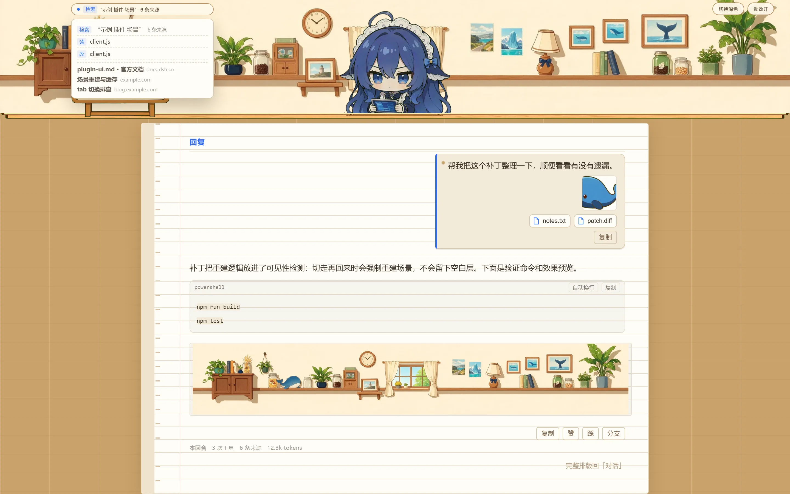
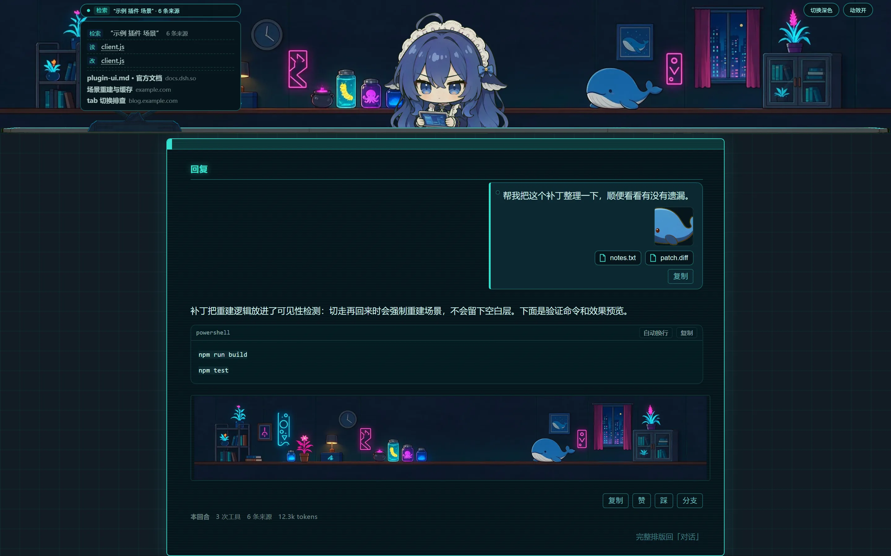
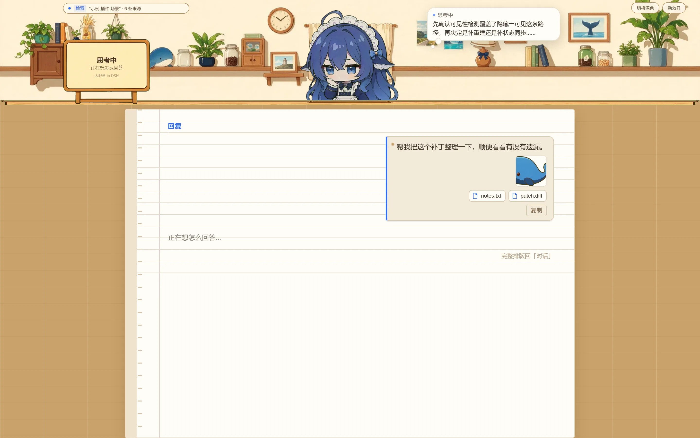

# 大肥鱼 in DSH

## English

A third conversation view for DeepSeek Harness (DSH), sitting beside **Chat** and **Trajectory**.

- **Ten live states**: idle, thinking, running a tool, waiting for approval / answer, error, plus laugh / sweat / sympathy / surprise / clap-done reactions driven by the real session.
- **Transcript** of the loaded session with copy, like/dislike and branch; a user tag with image and file attachments; reply images render inline and open a lightbox.
- **Workbench pill** on the left: the latest tool step of the turn; click to expand the full list with clickable file paths and web-search sources.
- **Attachments**: user files open our right-sidebar preview; images open a lightbox; the desk keeps file folders.
- **Code blocks**: fenced code keeps its language label, with one-click copy and a wrap toggle.
- **Width sync**: the desk page follows the native conversation width axis, so dragging the chat width resizes the output too.
- **Draggable character**: hold the character for a moment, then drag; she lifts above the output, looks surprised and struggles, and lands inside her normal walking band.
- **Light and dark** skins for wall, sign, table and props; the motion switch is remembered.

Install (npm): `dsh plugin --profile desktop add dsh-dafeiyu-counter@0.1.2`, or open **Plugins → Add plugin** and paste `dsh-dafeiyu-counter@0.1.2`. Tested on DSH 0.2.1-rc.5. This is a pure client UI: no extra services, API keys or network access.

License: MIT for the code. Artwork and upstream `dsh-pet` reuse are documented in [ASSET-LICENSE.md](./ASSET-LICENSE.md); runtime security notes are in [SECURITY.md](./SECURITY.md).

---

在 DSH 的「对话 / 轨迹」旁边增加第三个窗口：**大肥鱼 in DSH**。

场景带里是 2K 整图状态角色、状态牌和随机小物；下面是当前会话的完整记录、附件和操作。角色、状态牌、桌板、场景、小物都有浅色/深色两套。

## 十个状态

| 状态 | 你会看到 |
|---|---|
| 待命 | 安静站着，状态牌写「待命」 |
| 思考中 | 状态牌写「思考中」，右侧出现可滚动的思考泡泡 |
| 干活 | 状态牌写「干活」，显示正在执行的工具 |
| 等你批准 | 状态牌写「等你批准 / 等你回答 / 等你确认」 |
| 出错 | 状态牌写「出错」，表情收敛 |
| 大笑 | 思考中命中“有趣/好笑/幽默”等关键词，击掌大笑 |
| 流汗 | 命中“抱歉/限制/安全底线”等关键词 |
| 同情 | 命中“遗憾/悲伤/同情”等关键词 |
| 吃惊 | 命中“糟糕/oops/出错/害怕”等关键词 |
| 击掌完成 | 回答开始时的 2 秒完成击掌 |

状态来自 DSH 当前会话的真实状态；表情反应只在思考中触发，硬切，不做淡入。所有角色状态都是完整 2K 整图，不做脸/头/手叠层。

## 特性

- 第三会话视图，完整对话记录，用户输入吊牌、助手正文、复制/赞/踩/分支。
- 回复图片在消息内直接显示、点开灯箱；用户文件附件点开右侧栏预览；桌板只保留文件袋。
- 工作台胶囊：显示本回合最新一步工具/动作，点击就地展开全部（文件行可点、检索来源可点）。
- 代码块：围栏代码块带语言标签、一键复制、自动换行切换；引用里的代码块同样正确显示。
- 输出页宽度跟随原生对话页的宽度拖拽轴（同一 `--dsh-chat-content-width`）。
- 长按角色约 0.3 秒可拖动：惊讶脸 + 挣扎、拖动时置顶到输出区之上、落点限制在自由走动带内。
- 场景：背景墙、状态牌、10px 细分界、桌板、随机小物；浅色/深色两套。
- 主题和动效开关会记住（host-scoped cookie，localStorage 作为回退）。
- 动效跟随系统「减少动态」；设置可手动覆盖。

## 演示图

## 安装

- npm 安装：`dsh plugin --profile desktop add dsh-dafeiyu-counter@0.1.2`，或在 DSH 的「插件 → 添加插件」里填 `dsh-dafeiyu-counter@0.1.2`。
- 本地目录：DSH → 插件 → 添加插件 → 本地目录，选择本目录。

在 DSH 0.2.1-rc.5 上实测。插件是纯客户端 UI，不需要额外服务、API 密钥或网络权限。

## 资产复用与 AI 重绘

- 角色身份/设计沿用原始角色，原始动作素材来自 MIT 许可的 `dsh-pet`（Copyright (c) 2026 PC2005-cloud）。
- `idle` 是原始基础角色图复用并统一调色；其余 9 个状态为 AI 重绘（Seedream/Ark），从本项目自己的基础/姿势参考图生成，统一 V3 调色和蓝度。
- 背景墙、状态牌、桌板、小物为本项目生成的场景资产，复用；图标为角色图裁切。
- 旧的分层/旧状态/旧动作帧不包含在发布包中。

详见 [ASSET-LICENSE.md](./ASSET-LICENSE.md)。

## 安全与打包

- 纯客户端；无网络请求、无 API 密钥、无外部依赖、无 eval/子进程。
- 图片资产已剥离 EXIF/XMP/ICC 等元数据；发布包不含生成脚本、密钥、绝对路径或开发文件。
- 仅保留主题/动效偏好；不持久化对话内容。

详见 [SECURITY.md](./SECURITY.md)。

## 工作台与附件

- 场景左上有一枚和主题按钮同款的「工作台」胶囊：单行显示本回合**最新一步**工具/动作（随步骤实时替换），点击就地展开同宽面板看全部；展开高度按场景带计算，始终停在桌面上方；文件条目可直接点开右侧栏；没有工具活动时不出现。放左侧是为了不挡思考泡泡。
- 回复里的图片直接在对话记录里显示，点击看原图；桌板只放文件袋，不再放图片相框。
- 用户消息里的文件附件可点击，在右侧栏预览（文本 / 图片），其他类型可下载。
- 助手消息底部显示「本回合 · N 次工具 · M 条来源 · tokens」。

## 已知限制

- 只跟随当前加载的会话窗口；更早的轮次不在场景/输出区显示。
- 输出页渲染 Markdown 基础子集，不是完整 Markdown 渲染器；工具调用在输出页仍省略，汇总进工作台吊牌。
- 赞/踩直接写消息反馈，不弹官方分类对话框；分支需要当前会话有 fork 权限。
- 不是官方 Live2D Cubism；角色是整图状态切换，不做四肢/尾巴独立骨骼。
- 场景带和桌板固定，只有输出页滚动。

## 许可

代码与场景/角色美术的许可说明见 [ASSET-LICENSE.md](./ASSET-LICENSE.md)。上游 `dsh-pet` 的 MIT 许可见该文件。

## 更新记录

- 0.1.0：首个公开版本。第三会话视图（完整记录、复制/赞/踩/分支）、十种真实状态、亮/暗两套场景、内嵌图片（点开灯箱）、用户文件附件右侧栏预览、工作台胶囊（最新一步、同宽展开、文件可点）、代码块（语言标签/复制/自动换行）、回合信息行；紧凑视图按窗口宽度 760px 切换；无网络请求。
- 0.1.1：输出区的 `<https://…>` 与裸 URL 自动变成可点击链接（新标签打开，中文标点处正确断开）；工作台里的网页条目显示完整地址并可点击。
- 0.1.2：输出页宽度跟随原生对话页的宽度拖拽轴；长按拖动角色（惊讶脸 + 挣扎、拖动时置顶到输出区之上、固定上移 26px、落点限制在自由走动带）；补了拖动回位兜底（失焦/切后台/捕获丢失/60s 都会回正常 Y）；README 加演示图。

## 开发 / Development

- 源码：`client.js` 是单文件客户端插件，`index.js` 是宿主入口，`cordis.patch.yml` 是 bundle patch。
- 自测：`node --check client.js`、`node test/smoke.test.mjs`、`node test/bundle.test.mjs`。
- npm 上的 `0.1.2` 是**已发布版本**；`main` 分支可能包含尚未发布的小修复，安装请以 npm 版本为准。

